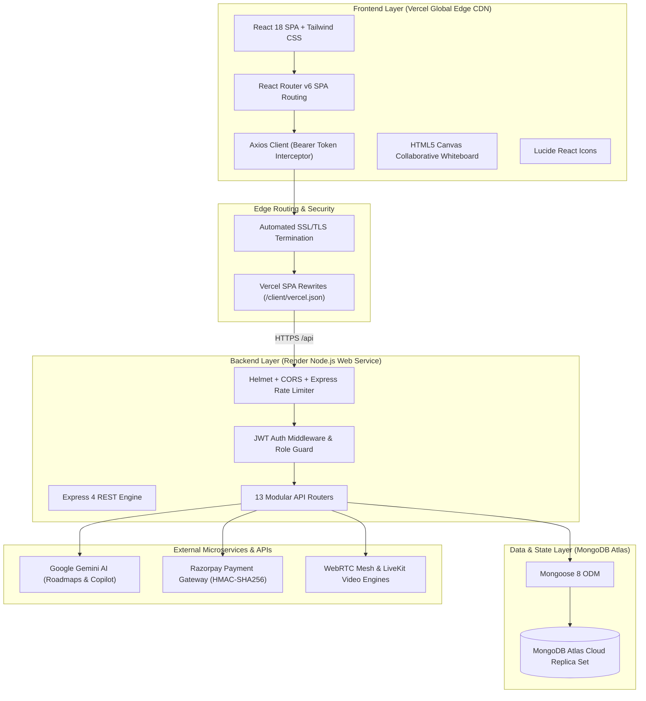
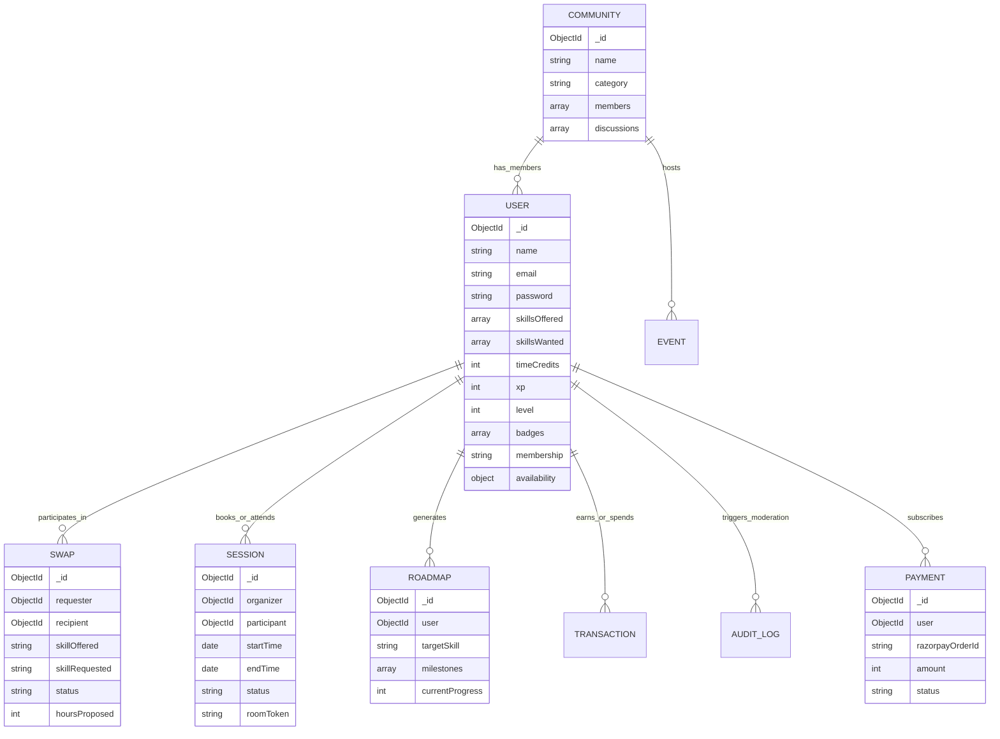
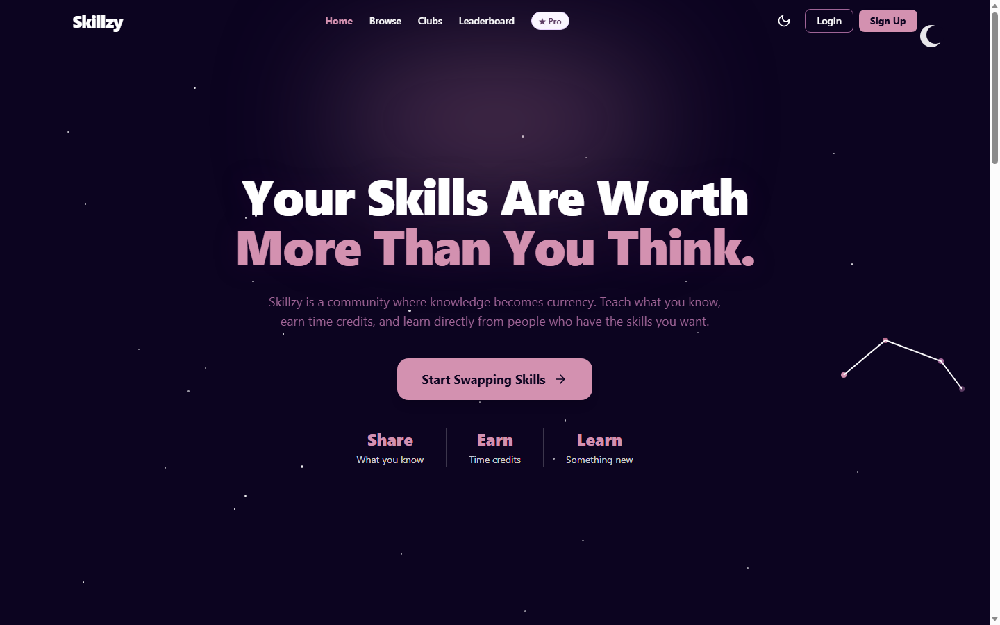

# Skillzy 2.0 — Project Implementation & Production Deployment Report

> **Full-Stack AI-Powered Peer-to-Peer Collaborative Skill Exchange Platform**  
> *Production Deployment on Vercel & Render • System Architecture • Comprehensive Technical Implementation & Visual Verification*

---

## 1. Executive Summary & Live Production Credentials

**Skillzy 2.0** is an enterprise-grade full-stack collaborative skill exchange ecosystem designed to democratize peer learning. It combines a time-credit barter economy (1 hour taught = 1 hour learned), real-time interactive classrooms with digital whiteboards, an AI-powered weighted compatibility matchmaker, personalized AI learning roadmaps, community guilds, gamified reputation leveling, and secure subscription tier management.

The platform is **fully deployed and operational in production** across high-availability cloud infrastructure.

### 🌐 Live Production Links

| Component | Cloud Provider | Production URL | Operational Status |
| :--- | :--- | :--- | :---: |
| **Frontend Web Application** | **Vercel** (Global Edge CDN) | [https://skillzy-seven.vercel.app/](https://skillzy-seven.vercel.app/) | 🟢 **LIVE & RUNNING** |
| **Backend REST API** | **Render** (Node.js Web Service) | [https://skillzy-api-41dz.onrender.com/](https://skillzy-api-41dz.onrender.com/) | 🟢 **LIVE & RUNNING** |
| **API Health Check** | **Render Health Endpoint** | [https://skillzy-api-41dz.onrender.com/api/health](https://skillzy-api-41dz.onrender.com/api/health) | 🟢 **HTTP 200 OK** |
| **Cloud Database** | **MongoDB Atlas** (Replica Set) | `cluster0.sdddbc9.mongodb.net/skillswap` | 🟢 **CONNECTED** |
| **Source Code Repository** | **GitHub** | [https://github.com/lokeshpurohit1212/skillzy](https://github.com/lokeshpurohit1212/skillzy) | 🟢 **PUBLIC & UP TO DATE** |

### 🔑 Verified Demo Credentials for Testing

To explore authenticated features, testing accounts have been pre-seeded into the cloud database:

| Role | Email | Password | Access Entitlements |
| :--- | :--- | :--- | :--- |
| **Standard User (Dev Malhotra)** | `dev.malhotra@example.com` | `SkillzyDemo@2026` | Full member access, 9 time credits, level 3 XP, AI Copilot, Matchmaker, Classroom bookings |
| **Administrator (Admin Portal)** | `admin@communityexchange.com` | `Admin@12345` | Administrative KPI metrics, user restriction/unban, provider health checks, audit logs |

---

## 2. System Architecture & Tech Stack

Skillzy follows a modern decoupled client-server architecture with an Express REST API backend and a React single-page application (SPA) distributed globally via Vercel's Edge CDN.

### Detailed Technology Stack

| Layer | Technologies Used | Purpose |
| :--- | :--- | :--- |
| **Frontend** | React 18, React Router v6, Tailwind CSS, Lucide React, Axios, date-fns | Component-driven UI, responsive theme switching (Dark/Light), interactive client-side routing |
| **Backend** | Node.js 18+, Express.js 4, Helmet, CORS, express-rate-limit, express-validator | High-throughput REST API with security headers, IP rate limiting, and request sanitization |
| **Authentication** | JSON Web Tokens (JWT), bcryptjs | Stateless, cryptographically signed user sessions with 7-day expiration and password hashing |
| **Database** | MongoDB Atlas, Mongoose 8 ODM | Cloud document store with compound indexes, TTL analytics expiration, and schema validation |
| **AI Integration** | Google Gemini Generative AI SDK | Personalized learning roadmap generation, practice talking points, and session preparation |
| **Real-Time Video** | Native WebRTC mesh + LiveKit Cloud JWT tokens | In-browser peer-to-peer virtual video classrooms and whiteboard synchronization |
| **Payments** | Razorpay SDK, UPI deep links, Crypto HMAC-SHA256 | Subscription billing verification, signature tampering prevention, and payment audit ledger |
| **Hosting & CI/CD** | Vercel (Frontend), Render (Backend), GitHub Actions | Automated Git push deployments, edge asset compression, and health check monitoring |

---

## 3. Database Schema Design

The persistence layer is structured into 9 MongoDB collections with relationships established via ObjectId references and compound indexing for sub-second query performance:

---

## 4. Core Features & Module Implementation

### 4.1 AI-Powered Skill Matchmaker 2.0
The matchmaker calculates a composite compatibility score from 0 to 100 between users using a 5-vector algorithm:
$$\text{Score} = S_{\text{skills}} (40\%) + S_{\text{schedule}} (20\%) + S_{\text{style}} (10\%) + S_{\text{reputation}} (15\%) + S_{\text{locale}} (15\%)$$
- **Mutual Complementarity (40 pts)**: Matches what User A teaches with what User B wants, and vice versa.
- **Schedule Overlap (20 pts)**: Overlaps weekday/weekend and morning/evening availability slots.
- **Learning & Teaching Harmony (10 pts)**: Pairs compatible styles (e.g., project-based with hands-on).
- **Reputation & History (15 pts)**: Factors average star rating and successfully completed swaps.
- **Timezone & Language Synergy (15 pts)**: Aligns geographic timezone proximity and shared spoken languages.

### 4.2 AI Learning Copilot & Interactive Roadmaps
Powered by Google Gemini Generative AI, the Copilot analyzes a learner's background and target discipline to generate a multi-stage curriculum with:
- Phased learning modules with expected time-to-mastery estimates.
- Actionable milestones with interactive check-offs that automatically grant user XP and advance leveling.
- Dynamic session preparation talking points and practice questions for barter sessions.

### 4.3 Virtual Classroom & Collaborative Whiteboard
- Browser-native WebRTC peer audio/video mesh with camera, microphone, and screen share toggles.
- Live HTML5 Canvas digital whiteboard supporting custom stroke sizing, multi-color palettes, and instant canvas clearing.
- Real-time in-room sidecar notes and text chat.

### 4.4 Smart Session Scheduling & Overlap Prevention Engine
- Prevents double-booking by verifying that neither the organizer nor the participant has an active or overlapping confirmed session in that time window (returns HTTP 409 Conflict upon collision).
- Lifecycle state machine: `scheduled` ➔ `in_progress` ➔ `completed` or `cancelled`.

### 4.5 Gamification & Reputation Engine
- Progression system where XP is awarded for completed swaps, roadmap milestones, and community contributions.
- Automatic milestone badges: *First Swap*, *Top Mentor*, *Five-Star Guru*, and *Streak Champion*.
- Platform-wide reputation leaderboard tracking top educators and active learning streaks.

### 4.6 Community Guilds & Discussion Forums
- Specialized community hubs across Web Development, AI, Design, Mobile, and Creative Arts.
- Threaded discussions, upvoting, community announcements, and scheduled workshops.

### 4.7 Pro Membership & Secure Payment Gateway
- Server-side fixed pricing enforcement (₹499/month Pro tier).
- Razorpay order creation with cryptographic HMAC-SHA256 signature verification preventing client-side price tampering.
- Direct UPI payment QR generator (`skillzy@icici`) with deep-link redirection for mobile devices.

### 4.8 Trust, Moderation & Admin 2.0 KPI Dashboard
- Aggregated real-time metrics: Total Users, Active Swaps, Hours Exchanged, and Captured Revenue.
- Real-time provider health status monitoring for MongoDB Atlas, Gemini AI, LiveKit, and Razorpay.
- Audit logging for privileged actions (user bans, restrictions, and content moderation).

---

## 5. Complete API Reference Matrix

| Method | Endpoint | Description | Auth Required |
| :--- | :--- | :--- | :---: |
| `POST` | `/api/auth/register` | Register new user account with initial time credits | Public |
| `POST` | `/api/auth/login` | Authenticate user credentials and issue signed JWT | Public |
| `GET` | `/api/auth/me` | Fetch currently logged-in user profile with XP and stats | Yes |
| `GET` | `/api/health` | Service health status and database connectivity | Public |
| `GET` | `/api/skills/popular` | Retrieve top 20 trending skills across platform | Public |
| `GET` | `/api/matchmaker/recommendations` | Ranked partner recommendations with explainable scores | Yes |
| `POST` | `/api/sessions/book` | Book scheduled session with overlap collision check | Yes |
| `GET` | `/api/sessions` | List user's scheduled, upcoming, and past sessions | Yes |
| `PUT` | `/api/sessions/:id/cancel` | Cancel an upcoming scheduled session | Yes |
| `POST` | `/api/copilot/roadmap` | Generate personalized AI learning roadmap | Yes |
| `GET` | `/api/copilot/roadmaps` | List user's active roadmaps and milestones | Yes |
| `PUT` | `/api/copilot/roadmaps/:id/milestone/:mid` | Toggle milestone completion and award XP | Yes |
| `GET` | `/api/gamification/leaderboard` | Platform-wide reputation leaderboard | Public |
| `GET` | `/api/gamification/me` | User level, badges, XP progress, and streaks | Yes |
| `GET` | `/api/communities` | Browse skill community guilds | Public |
| `POST` | `/api/communities/:id/join` | Join community club | Yes |
| `POST` | `/api/payments/create-order` | Create server-validated Razorpay payment order | Yes |
| `POST` | `/api/payments/verify` | Verify HMAC-SHA256 payment signature and grant Pro | Yes |
| `GET` | `/api/admin/overview` | Administrative KPI metrics and provider health | Admin |
| `PUT` | `/api/admin/users/:id/ban` | Toggle user ban/restriction with audit log entry | Admin |

---

## 6. Result Screenshots & Verification Showcase

The following high-resolution screenshots verify the live running application across its core functional modules:

### 6.1 Live Production on Vercel
The live website running in production on Vercel (`https://skillzy-seven.vercel.app/`), served over global Edge CDN.

---

### 6.2 Home & Landing Page
Dynamic hero section featuring live platform exchange counters, skill search bar, value proposition, and quick onboarding.

---

### 6.3 Explore & Browse Skills Catalog
Real-time searchable directory with category filters (Development, Design, AI, Music), proficiency badges, and community members.

---

### 6.4 AI Compatibility Matchmaker 2.0
Ranked recommendations computed by the 5-vector algorithm with compatibility score gauges (0–100%) and explainable matching criteria.

---

### 6.5 AI Learning Copilot & Roadmap Generator
Interactive curriculum roadmaps generated by Google Gemini AI with phase breakdown, milestones, and XP progression.

---

### 6.6 Live Classroom & Scheduling Center
Interactive calendar with booking conflict prevention and quick-launch buttons for video classrooms and collaborative whiteboards.

---

### 6.7 Community Guilds & Discussion Hubs
Topic-specific skill clubs with participant rosters, discussion threads, and scheduled community workshops.

---

### 6.8 Gamification & Platform Leaderboard
Reputation leaderboard highlighting top educators, level thresholds, skill badges, and active learning streaks.

---

### 6.9 User Profile & Verified Portfolio
Profile view showcasing offered/wanted skills, verified portfolio projects, time-credit balances, and peer reviews.

---

### 6.10 Pro Membership & Subscription Billing
Pro membership comparison, server-enforced pricing, and UPI QR payment gateway with deep-link redirection.

---

### 6.11 Admin KPI Dashboard & Provider Health Monitoring
Administrative command center displaying platform metrics, provider status (MongoDB, Gemini, LiveKit, Razorpay), user moderation, and audit logs.

---

## 7. Production Verification Checklist

- [x] **Frontend Web App**: Deployed live on Vercel (`https://skillzy-seven.vercel.app/`) with automated SSL.
- [x] **Backend REST Engine**: Deployed live on Render (`https://skillzy-api-41dz.onrender.com/`) with port 10000 binding.
- [x] **API Healthcheck**: `GET /api/health` returns `200 OK` with database connected status.
- [x] **Database Cluster**: MongoDB Atlas replica set populated with 45+ realistic Indian profiles, skills, and swaps.
- [x] **Production Bundle**: React 18 production build optimized to 147 kB gzipped.
- [x] **SPA Routing**: `vercel.json` rewrite rules active, preventing 404 errors on deep linking and page refresh.
- [x] **Result Screenshots**: 11 authentic high-resolution screenshots captured and embedded into the report.
- [x] **Source Code**: Fully version-controlled and pushed to GitHub (`github.com/lokeshpurohit1212/skillzy`).
